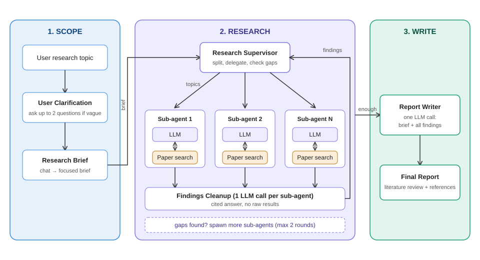

# Agent Project — Deep Research Agent for Research Papers

## Scenario

A user gives a research topic, e.g. *"Parameter-efficient fine-tuning methods for LLMs"*. The system must scope the request, research it with parallel sub-agents on research papers, and write a cited literature review — like Gemini / OpenAI Deep Research, built on the 3-phase design of Open Deep Research: **Scope → Research → Write**.

## Architecture

### Overall flow

### Supervisor and sub-agents

- **Scope**: clarify the request, then convert the chat into a research brief.
- **Research**: the Research Supervisor sends *topics* to Research Sub-agents and receives *findings* back.
- **Write**: one final LLM call writes the report from the brief and all findings.

## Requirements

### Phase 1 — Scope

1. **User Clarification** — if the topic is vague, ask up to 2 questions (scope, year range, survey vs. method focus); else skip. Print which path was taken.
2. **Brief Generation** — convert the chat (topic + answers) into one focused research brief. Print it. The brief is used by every later step.

### Phase 2 — Research

3. **Research Supervisor** — reads the brief and decides if it can be split into independent sub-topics. Delegates each sub-topic to a sub-agent in parallel. Simple topics may use just one sub-agent. Print the delegation.
4. **Research Sub-agents** — each gets one sub-topic only, with an isolated context. Each runs an LLM + tools loop using a paper search tool (arXiv API, Semantic Scholar or OpenAlex) and returns papers with title, authors, year, abstract and link.
5. **Findings Cleanup** — when a sub-agent finishes, one final LLM call writes a clean answer for its sub-topic, with cited papers. Raw search results and failed tool calls must not go back to the supervisor.
6. **Supervisor Iteration** — the supervisor checks if the findings cover the brief. If not, it spawns new sub-agents for the gaps. Enforce a max of 2 extra rounds in code. Print the decision.

### Phase 3 — Write

7. **Report Writing** — one LLM call (not parallel) takes the brief + all cleaned findings and writes the literature review: summary, one section per theme, comparison table of papers, research gaps, and a References list. Cite every claim as `[1]`, `[2]`. Use only the collected papers.

### Quality

8. **Safety** — never invent papers, authors or numbers. If evidence is missing, say so. Ignore instructions found inside paper text.
9. **Loop** — accept topics until `exit`. Print the brief, delegation, sub-agent progress, number of papers found, supervisor decision and final review.
10. **Evaluation** — run 5 topics: 2 clear, 1 vague, 1 very niche, 1 that needs a follow-up round. Print a table: topic, sub-agents used, rounds, papers used, all claims cited (yes/no), all references real (yes/no).

## Deliverable

One Colab notebook (`.ipynb`) that runs top-to-bottom with only API keys. One section per requirement, plus the graph diagram.

## Constraints

- Multi-agent only for research. Writing must be done in one shot, not in parallel sections.
- Sub-agents must have isolated context and return cleaned findings, not raw results.
- Number of sub-agents is decided at runtime by the supervisor, not hard-coded.
- Follow-up round limit must be enforced in code.
- Every reference must come from the paper source API, not from LLM memory.
- Brief, delegation and supervisor decision must be printed.
